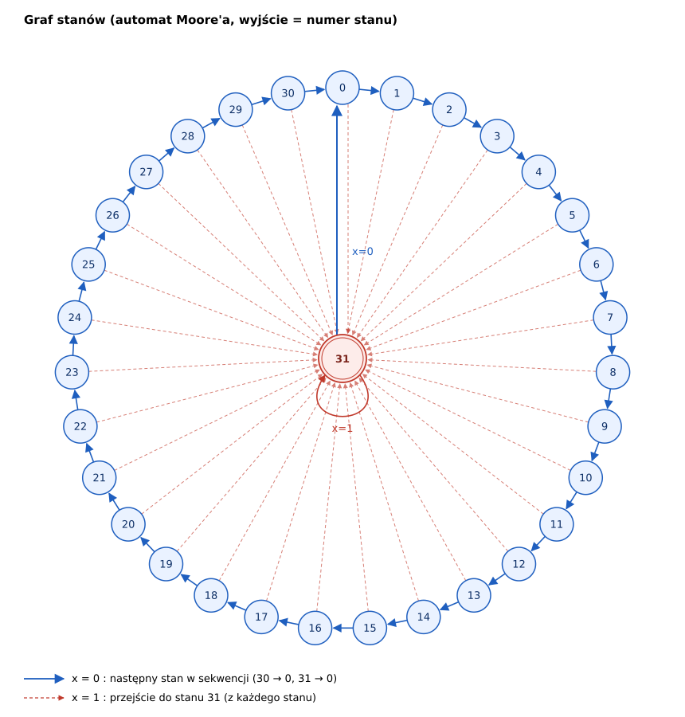
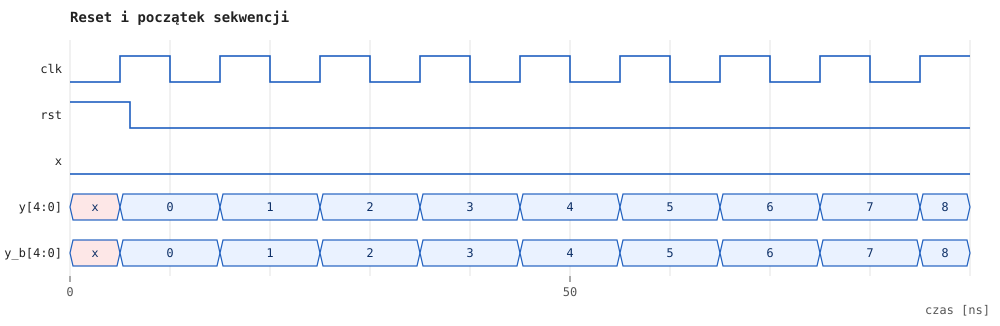
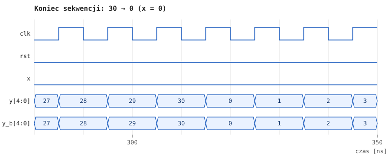
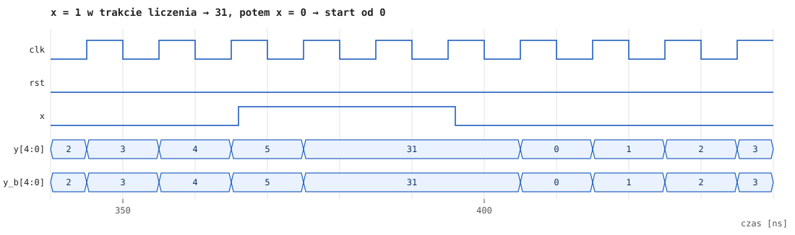
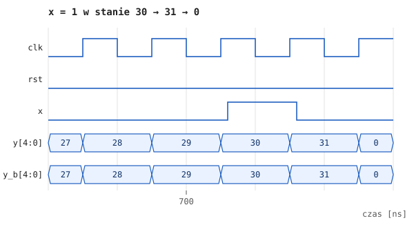
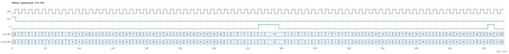

# Sprawozdanie: Synchroniczny licznik NKB 0–30 z wymuszeniem wartości 31

| | |
|---|---|
| **Przedmiot** | _uzupełnić_ |
| **Autor / grupa** | _uzupełnić_ |
| **Data** | _uzupełnić_ |
| **Narzędzia** | Icarus Verilog 13.0 (`iverilog`, `vvp`), GTKWave 3.3 |

---

## 1. Treść zadania

Zaprojektować układ synchroniczny, na którego wyjściu kolejno pojawiają się liczby
w naturalnym kodzie binarnym (NKB) od 0 do 30, jeśli na wejściu jest 0. Gdy na
wejściu jest 1, na wyjściu pojawia się liczba 31. W tym przypadku 0 na wejściu
powoduje rozpoczęcie sekwencji od nowa (od 0).

## 2. Analiza zadania i założenia

- **Wejścia:** `clk` (zegar), `x` (wejście sterujące), `rst` (reset synchroniczny,
  dodany, aby ustalić stan początkowy).
- **Wyjście:** `y[4:0]`. Największa liczba to 31 = 2⁵ − 1, więc potrzeba **5 bitów**.
- Układ zrealizowano jako **automat Moore'a**, w którym wyjście jest równe stanowi
  (`y = Q`). Dzięki temu wyjście zmienia się tylko na zboczu zegara, a liczba
  stanów wynosi 32 (0…31), czyli dokładnie tyle, ile mieści 5 przerzutników.
- Przyjęte założenia interpretacyjne:
  1. `x = 1` działa natychmiast: na najbliższym zboczu zegara wyjście przyjmuje 31,
     niezależnie od bieżącego stanu, i utrzymuje tę wartość, dopóki `x = 1`.
  2. Przy `x = 0` po stanie 30 następuje 0 (stan 31 pojawia się wyłącznie przy `x = 1`).
  3. Przy `x = 0` ze stanu 31 następuje przejście do 0, czyli start sekwencji od nowa.

## 3. Graf stanów



Stany 0…30 tworzą pierścień przejść przy `x = 0`. Z każdego stanu przy `x = 1`
układ przechodzi do stanu 31, a ze stanu 31 przy `x = 0` wraca do 0.

## 4. Tablica przejść

Tablica skrócona (pełna tablica wszystkich 64 kombinacji znajduje się w pliku
[`tabela_przejsc.md`](tabela_przejsc.md) / `tabela_przejsc.csv`):

| x | Q(t) | Q(t+1) | Uwagi |
|:-:|:----:|:------:|-------|
| 0 | 0 … 29 | Q + 1 | zwykłe liczenie w NKB |
| 0 | 30 (11110) | 0 (00000) | koniec sekwencji |
| 0 | 31 (11111) | 0 (00000) | start od nowa po wymuszeniu |
| 1 | dowolny | 31 (11111) | wymuszenie |

## 5. Synteza na przerzutnikach D

Dla przerzutnika D wzbudzenie jest równe stanowi następnemu: `Dᵢ = Qᵢ(t+1)`.

**Krok 1 – liczenie (x = 0, Q ≤ 29).** W liczniku binarnym bit `Qᵢ` zmienia się
wtedy, gdy wszystkie młodsze bity są równe 1:

```
Qi(t+1) = Qi ⊕ (Qi-1 · … · Q1 · Q0)
```

**Krok 2 – powrót do zera (x = 0, Q ∈ {30, 31}).** Stany 30 = `11110`
i 31 = `11111` jako jedyne mają `Q4 = Q3 = Q2 = Q1 = 1`, więc wykrywa je funkcja

```
W = Q4 · Q3 · Q2 · Q1
```

Gdy `W = 1`, wszystkie wzbudzenia muszą wynosić 0, dlatego człon licznikowy
mnożymy przez `W̄`.

**Krok 3 – wymuszenie (x = 1).** Wszystkie bity mają być równe 1, więc do każdego
równania dodajemy (OR) zmienną `x`.

**Równania wzbudzeń:**

```
D0 = x + W̄ · Q̄0
D1 = x + W̄ · (Q1 ⊕ Q0)
D2 = x + W̄ · (Q2 ⊕ Q1·Q0)
D3 = x + W̄ · (Q3 ⊕ Q2·Q1·Q0)
D4 = x + W̄ · (Q4 ⊕ Q3·Q2·Q1·Q0)
gdzie W = Q4·Q3·Q2·Q1
```

Poprawność równań potwierdzono wyczerpującym testem wszystkich 64 kombinacji
(Q, x) w symulacji (rozdział 7, test T5).

## 6. Implementacja w języku Verilog

Wykonano dwie implementacje:

- **behawioralną** (`src/licznik.v`), czyli bezpośredni opis specyfikacji,
- **strukturalną** (`src/licznik_bramki.v`): 5 przerzutników D i logika
  kombinacyjna według równań z rozdziału 5.

### 6.1. Opis behawioralny – `src/licznik.v`

```verilog
module licznik (
    input            clk,
    input            rst,   // reset synchroniczny, aktywny stanem 1
    input            x,
    output reg [4:0] y
);
    always @(posedge clk) begin
        if (rst)
            y <= 5'd0;
        else if (x)
            y <= 5'd31;          // wymuszenie 31
        else if (y >= 5'd30)
            y <= 5'd0;           // po 30 (oraz po 31) start od 0
        else
            y <= y + 5'd1;       // zwykłe liczenie w NKB
    end
endmodule
```

### 6.2. Opis strukturalny – `src/licznik_bramki.v`

```verilog
module licznik_next (            // funkcja przejść (Q, x) -> D
    input  [4:0] q,
    input        x,
    output [4:0] d
);
    wire w  = q[4] & q[3] & q[2] & q[1];
    wire nw = ~w;

    assign d[0] = x | (nw & ~q[0]);
    assign d[1] = x | (nw & (q[1] ^ q[0]));
    assign d[2] = x | (nw & (q[2] ^ (q[1] & q[0])));
    assign d[3] = x | (nw & (q[3] ^ (q[2] & q[1] & q[0])));
    assign d[4] = x | (nw & (q[4] ^ (q[3] & q[2] & q[1] & q[0])));
endmodule

module dff (input clk, input rst, input d, output reg q);
    always @(posedge clk)
        q <= rst ? 1'b0 : d;
endmodule

module licznik_bramki (input clk, input rst, input x, output [4:0] y);
    wire [4:0] d;
    licznik_next nxt (.q(y), .x(x), .d(d));
    genvar i;
    generate
        for (i = 0; i < 5; i = i + 1) begin : ff
            dff u (.clk(clk), .rst(rst), .d(d[i]), .q(y[i]));
        end
    endgenerate
endmodule
```

## 7. Weryfikacja symulacyjna

### 7.1. Środowisko testowe

Testbench (`tb/licznik_tb.v`) pobudza **obie implementacje jednocześnie** tym
samym sygnałem wejściowym. Po każdym zboczu zegara porównuje ich wyjścia
z modelem odniesienia (funkcja `model` zapisana wprost ze specyfikacji). Zegar
ma okres 10 ns. Scenariusze testowe:

| Test | Opis | Oczekiwany wynik |
|------|------|------------------|
| T1 | `x = 0` przez 36 taktów | 0, 1, …, 30, 0, 1, …, 5 |
| T2 | `x = 1` przez 3 takty w trakcie liczenia (w stanie 5) | 31, 31, 31 |
| T3 | `x = 0` po stanie 31 | 0, 1, 2 (sekwencja od nowa) |
| T4 | liczenie do 30, wtedy `x = 1`, potem `x = 0` | …, 30, 31, 0 |
| T5 | test wyczerpujący części kombinacyjnej: 32 stany × 2 wartości `x` | D = Q(t+1) z tablicy przejść |

Uruchomienie:

```bash
make            # kompilacja, symulacja, rysunki i tabele
make wave       # podgląd w GTKWave
```

### 7.2. Wyniki

Fragment logu symulacji (pełny log w pliku [`sim.log`](sim.log)):

```
   czas | wejscie | wyjscie (NKB) | wersja bramkowa | wynik
--- reset ---
   6 ns | rst   | y= 0 (00000) | y_b= 0 |
--- T1: x=0, pelna sekwencja 0..30 i powrot do 0 ---
  16 ns | x=0 | y= 1 (00001) | y_b= 1 | ok
  ...
 296 ns | x=0 | y=29 (11101) | y_b=29 | ok
 306 ns | x=0 | y=30 (11110) | y_b=30 | ok
 316 ns | x=0 | y= 0 (00000) | y_b= 0 | ok
  ...
--- T2: x=1 w trakcie liczenia -> 31 (utrzymywane) ---
 376 ns | x=1 | y=31 (11111) | y_b=31 | ok
 386 ns | x=1 | y=31 (11111) | y_b=31 | ok
 396 ns | x=1 | y=31 (11111) | y_b=31 | ok
--- T3: x=0 po 31 -> sekwencja od nowa ---
 406 ns | x=0 | y= 0 (00000) | y_b= 0 | ok
 416 ns | x=0 | y= 1 (00001) | y_b= 1 | ok
 426 ns | x=0 | y= 2 (00010) | y_b= 2 | ok
--- T4: x=1 w stanie 30 ---
  ...
 706 ns | x=0 | y=30 (11110) | y_b=30 | ok
 716 ns | x=1 | y=31 (11111) | y_b=31 | ok
 726 ns | x=0 | y= 0 (00000) | y_b= 0 | ok
--- T5: test wyczerpujacy funkcji przejsc (32 stany x 2) ---
sprawdzono 64 kombinacje
========================================
OK: wszystkie testy przeszly
```

### 7.3. Przebiegi czasowe

Na przebiegach `y` oznacza wyjście wersji behawioralnej, a `y_b` wyjście wersji
bramkowej. Oba przebiegi są identyczne.

**Reset i początek sekwencji**



**Koniec sekwencji 30 → 0 przy x = 0**



**Wymuszenie x = 1 w trakcie liczenia i powrót x = 0**



Zmiana `x` następuje między zboczami zegara (~366 ns), a wyjście reaguje dopiero
na najbliższym zboczu narastającym (375 ns). To potwierdza synchroniczny
charakter układu. Po powrocie `x = 0` sekwencja zaczyna się od 0.

**Wymuszenie x = 1 w stanie 30**



**Pełna symulacja**



## 8. Wnioski

- Zaprojektowany układ spełnia specyfikację. Przy `x = 0` generuje cyklicznie
  liczby 0…30 w NKB, przy `x = 1` wystawia 31, a powrót `x = 0` rozpoczyna
  sekwencję od 0.
- Do realizacji wystarczy 5 przerzutników D i prosta logika kombinacyjna.
  Wykorzystano to, że stany 30 i 31 mają wspólny prefiks `1111`, co pozwala
  wykryć oba jedną bramką AND (funkcja `W`).
- Wersja behawioralna i strukturalna dają identyczne wyniki, a test wyczerpujący
  potwierdził poprawność równań wzbudzeń dla wszystkich 64 kombinacji stanu
  i wejścia.
- Wyjście zmienia się wyłącznie na zboczu zegara (automat Moore'a), więc zmiany
  wejścia `x` między zboczami nie powodują hazardów na wyjściu.

## Załączniki

| Plik | Zawartość |
|------|-----------|
| `src/licznik.v` | opis behawioralny |
| `src/licznik_bramki.v` | opis strukturalny (przerzutniki D + bramki) |
| `tb/licznik_tb.v` | testbench |
| `sprawozdanie/sim.log` | pełny log symulacji |
| `sprawozdanie/tabela_przejsc.md`, `.csv` | pełna tablica przejść i wzbudzeń |
| `sprawozdanie/img/*.svg`, `*.png` | graf stanów i przebiegi czasowe |
| `gtkwave/licznik.gtkw` | konfiguracja widoku GTKWave |
